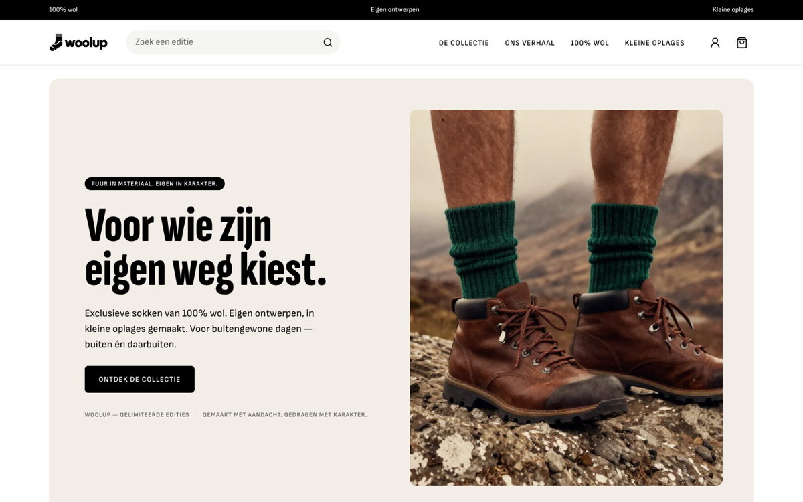

# woolup.shop

De webshop van woolup: sokken van 100% wol, eigen ontwerpen, kleine oplages. Dit is de Hostinger Horizons-build (nu Hostinger AI-bouwer) die gekoppeld is aan de echte Hostinger-winkel (producten, winkelwagen en checkout), met de vormgeving uit `docs/design.md`. Die is vlak en modern, met zachte hoeken, lichte randen, kleine hoofdletters en het woolup-logo.



## Opbouw
Een monorepo zoals Horizons hem exporteert:

| Map | Wat |
| --- | --- |
| `apps/web` | De site: React Router (SSR), Vite, Tailwind CSS, Express (`server.ts`) |
| `apps/pocketbase` | Database voor accounts (inloggen, account aanmaken) |
| `docs/` | Brief en designkeuzes |

## Lokaal draaien
Je hebt [Bun](https://bun.sh) en Node.js 22 nodig.

```bash
bun install
cd apps/web
bun run dev          # ontwikkelserver op http://localhost:3000
bun run typecheck
bun run lint
bun run build        # productiebuild naar dist/apps/web
bun run start        # draait de build
```

Accounts werken alleen als PocketBase meedraait: `bun run dev` in de root start beide.

## Waar staat wat
Alle vormgeving zit in bestaande bestanden van de Horizons-export. Er zijn geen nieuwe bestanden, pakketten of config-wijzigingen, zodat alles in de code-editor van de Hostinger AI-bouwer te plakken is (zie *Live zetten*).

| Wat | Waar |
| --- | --- |
| Kleuren, fonts (Sofia Sans via Google Fonts), knoppen, velden | `apps/web/src/index.css` |
| Footer, plus het logo (`Logo`, `SockMark`) en `useModalPanel` voor lades | `apps/web/src/components/site-footer.tsx` |
| Header met zoekbalk, menu en winkelwagenknop | `apps/web/src/components/site-header.tsx` |
| Winkelwagen-pagina en -lade (`openCartDrawer()`) | `apps/web/src/components/cart-view.tsx` |
| Productkaart, snelle toevoegknop, carrousel, prijshulpjes | `apps/web/src/components/product-grid.tsx` |
| Homepagina | `apps/web/src/components/home/` |
| Collectie met filters | `apps/web/src/components/catalog.tsx` |
| Productpagina | `apps/web/src/components/product-detail.tsx` |
| Verhaalpagina's (verhaal, wol, productie, contact) | `apps/web/src/data/pages.ts` |
| Koppeling met de winkel | `apps/web/src/api/ecommerce-api.ts`; **niet aanpassen**, Horizons beheert dit bestand |
| Logo-bestanden | `docs/brand/` |

## Producten beheren
Producten, prijzen en foto's komen rechtstreeks uit de Hostinger-winkel, niet uit de code. Wat je in de winkel-admin invult, verschijnt vanzelf op de site:

- **Maten:** geef een product de optie **"Maat"** met waarden (bijvoorbeeld 35–38, 39–42, 43–46). Dan verschijnen het maatfilter in de collectie, de maatknoppen op de productpagina en de maatkeuze onder "In de winkelwagen" op de kaarten.
- **Sale-prijs:** dan tonen de kaart en de productpagina de doorgestreepte oude prijs en een "-x%"-badge.
- **Ribbon-tekst** (bijvoorbeeld "Nieuw" of "Bestseller"): een groen label op de kaart, in plaats van het standaardlabel "Gelimiteerde editie".
- **Voorraad bijhouden:** dan toont de productpagina "X paar beschikbaar". Bij een uitverkochte uitvoering worden de knoppen uitgeschakeld.
- **Meerdere foto's:** dan verschijnen op de productpagina miniaturen.
- **Beoordelingen:** die staan in de winkel nu uit. Zet je ze aan in de winkel-admin, dan verschijnt "Ervaringen" op de productpagina.

## Live zetten in de Hostinger AI-bouwer
Hostinger kan geen zip terugzetten in de AI-bouwer. Je kunt wel bestaande bestanden aanpassen in het **Code**-tab. Zo werkt het:

1. hPanel → **Websites** → woolup.shop → **Edit site**, en open het **Code**-tab bovenin.
2. Vervang per bestand de hele inhoud (alles selecteren, plakken, opslaan), in deze volgorde:
   1. `apps/web/src/index.css`
   2. `apps/web/src/components/site-footer.tsx`
   3. `apps/web/src/components/cart-view.tsx`
   4. `apps/web/src/components/product-grid.tsx`
   5. `apps/web/src/components/site-header.tsx`
   6. `apps/web/src/components/home/hero.tsx`
   7. `apps/web/src/components/home/featured.tsx`
   8. `apps/web/src/components/home/story.tsx`
   9. `apps/web/src/components/catalog.tsx`
   10. `apps/web/src/components/product-detail.tsx`
   11. `apps/web/src/components/product-reviews.tsx`
   12. `apps/web/src/components/account-view.tsx`
   13. `apps/web/src/components/editorial-page.tsx`
   14. `apps/web/src/components/cookie-banner.tsx`
   15. `apps/web/src/routes/home.tsx`
   16. `apps/web/src/routes/collectie.tsx`
   17. `apps/web/src/routes/checkout-success.tsx`
   18. `apps/web/src/routes/checkout-cancelled.tsx`
3. Optioneel, als `apps/web/src/root.tsx` te bewerken is: de versie uit de plakgids. Die geeft de sok als favicon en een nette 404-pagina.
4. Bekijk de preview: de homepagina, de collectie, een product, en toevoegen aan de winkelwagen. Daarna **Publiceren**.

Prompt de AI niet tussendoor, want dan kan hij bestanden terugschrijven. De originele export is je back-up.

## Claude Code: Alpaca MCP-server
`.mcp.json` registreert de [Alpaca MCP-server](https://github.com/alpacahq/alpaca-mcp-server) voor dit project (vereist [`uv`](https://docs.astral.sh/uv/)). De sleutels komen uit je omgeving en worden nooit gecommit:

```bash
export ALPACA_API_KEY=your_alpaca_api_key
export ALPACA_SECRET_KEY=your_alpaca_secret_key
# Paper trading is the default. Set ALPACA_PAPER_TRADE=false only with live keys.
```
