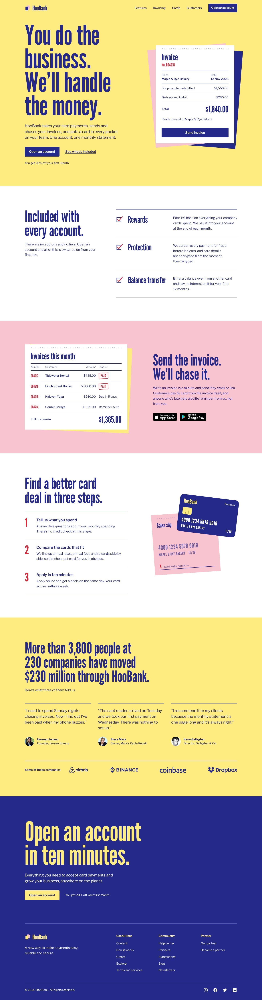

# HooBank - Business Website Template

Responsive business website design made with React and Tailwind CSS.

⚠️ **All names, information and assets used are fake and do not represent a real company.** ⚠️

Live demo can be found under this [**link**](https://business-website-template.onrender.com/).



## Design
The page borrows from the carbon-copy invoice book: a white top copy, canary and pink duplicates, and everything printed in one carbon-blue ink, with red kept for serial numbers and the "Paid" stamp.

| Token | Value | Used for |
| --- | --- | --- |
| `canary` | `#ffec80` | Hero and customer sections |
| `pink` | `#f8c4d0` | Invoicing section, copy sheets |
| `carbon` | `#25298a` | All text, buttons, footer |
| `stamp` | `#d8283a` | Serial numbers, stamps, step numbers |
| `white` | `#ffffff` | Top sheets and plain sections |

Headings are set in League Gothic and body text in Libre Franklin, both self-hosted through Fontsource. Colors, fonts and the type scale live in `tailwind.config.cjs`; all copy, links and sample data live in `src/constants/index.js`.

## Layout
- Header
- Hero section with a sample invoice you can send and see stamped as paid
- Features section
- Invoicing section
- Cards section
- Customers section (figures, testimonials and client logos)
- Call to action section
- Footer

## Built With
- React.js
- Tailwind CSS
- Vite

## Running locally
```bash
npm install
npm run dev
```

## Claude Code: Alpaca MCP server
`.mcp.json` registers the [Alpaca MCP server](https://github.com/alpacahq/alpaca-mcp-server) for this project (requires [`uv`](https://docs.astral.sh/uv/)). Keys are read from your environment and never committed:

```bash
export ALPACA_API_KEY=your_alpaca_api_key
export ALPACA_SECRET_KEY=your_alpaca_secret_key
# Paper trading is the default. Set ALPACA_PAPER_TRADE=false only with live keys.
```

Then start `claude` in this folder and approve the `alpaca` server when prompted.

## Acknowledgments
- [**Original Figma Design**](https://www.figma.com/file/bUGIPys15E78w9bs1l4tgS/HooBank?node-id=310%3A485&t=Jkk7MU9hZJ5HoVph-0), which the content and section structure started from
- [**JavaScript Mastery video**](https://youtu.be/_oO4Qi5aVZs)
